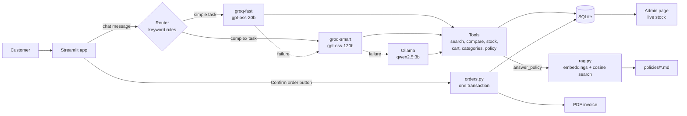

# 🛒 ShopAgent-AI

A conversational shopping assistant for an online store. The customer talks to an LLM agent in **Arabic or English**; the agent searches the product database, compares products, checks stock, fills the cart, and answers **return and warranty questions from a policy document**. The customer then confirms the order with a button, and the app updates the stock and generates a **PDF invoice**. A separate **admin page** shows live stock levels.

**[▶ Watch the demo video](https://drive.google.com/file/d/1GdK7IaI6nHsueSitul_NJib8QT48wJk2/view?usp=sharing)**

## Features

- **Natural-language shopping** in Arabic and English: search, details, compare, stock check, cart
- **Catalog browser** next to the chat: main categories, the types inside each, products with an "Add to cart" button
- **Policy questions** (returns, refunds, warranty, return shipping) answered from `policies/*.md` with a multilingual embedding search, so an Arabic question finds the English policy text; the agent must answer only from the retrieved text and cite its source
- **Tool-calling agent with memory:** it understands "add the second one" and follow-ups such as "and how long does it last?"
- **Task-based model routing** between two Groq models, with a **local Ollama model as the last-resort fallback**
- **Safe ordering:** the agent can *not* place orders; only the **Confirm order** button can (no LLM involved)
- **All-or-nothing orders:** stock check, order, stock deduction and cart clearing run in one SQLite transaction
- **PDF invoices** and a **live admin dashboard** (stock per product and category, low-stock alerts, recent orders)
- **Three layers of checks:** unit tests, a plumbing test of the policy tool with a fake LLM, and live evaluations of the real agent

## Architecture



**How a request flows:** the router classifies the message with cheap keyword rules (no extra LLM call). Comparisons, requests that refer to earlier results ("the first one") and cart changes go to the larger model; simple lookups go to the faster one. If a model fails, the next one continues the same conversation (they share one memory). The local model is always last.

## Design decisions

| Decision                                                                                                     | Why                                                                                       |
| ------------------------------------------------------------------------------------------------------------ | ----------------------------------------------------------------------------------------- |
| The cart is stored in the database, keyed by conversation id                                                 | The LLM can forget or invent cart contents                                                |
| The agent has no ordering tool                                                                               | Confirmation does not depend on the LLM following instructions                            |
| Orders run in one transaction with a stock guard                                                             | No half-saved orders, no negative stock                                                   |
| Tool results are never empty lists                                                                           | Some LLM APIs reject empty tool messages (found while testing)                            |
| Search matches product name **or category path**                                                             | Product names often don't contain words like "smartphone"                                 |
| The real category list is injected into the prompt                                                           | Stops the agent from offering products the store doesn't sell                             |
| Policy search uses a **multilingual** embedding model                                                        | Arabic questions match the English policy without translation                             |
| Policy search is a numpy dot product, not a vector database                                                  | There are only a few sections; FAISS would add an install risk for no gain                |
| The "not found" decision uses the **raw** similarity; the topic boost only orders results                    | The boost can neither create a match nor hide one (a bug of the first version)            |
| The policy tool reads the customer's messages itself and merges a short follow-up with the previous question | The model's own rewrite is not trusted, and a follow-up alone has lost its topic          |
| The customer sees the document **title** as the source, never a file name                                    | File names are internal                                                                   |
| The evaluation judges the model's **own** reply separately from the displayed reply                          | The app adds a source label and a fallback excerpt; those must not count as model quality |

## Policy answers

`rag.py` splits each file in `policies/` at its `##` headings. Each section and each question is embedded with `paraphrase-multilingual-MiniLM-L12-v2` (sentence-transformers). The best section is the one with the highest cosine similarity, and it is returned only if that similarity reaches `RAG_MIN_SCORE`. The agent's `answer_policy` tool hands the section to the LLM, which must answer only from it, in the customer's language, and end with the document title as the source. If nothing matches, or retrieval fails, the agent says it cannot verify the policy and never invents days, amounts or conditions.

**Things to know**

- **First use needs internet and memory.** The first policy question downloads the embedding model (a few hundred MB) and loads it with PyTorch, so it is slow once per server start.
- **The similarity threshold is a starting value (0.30).** Run `python calibrate_rag.py` to measure how well policy questions and unrelated questions separate for your model and policy, then set `RAG_MIN_SCORE` in `.env`. The question lists in that script are small and hand-written, so treat the result as a starting point.
- **Topic boost.** A small keyword rule table (`TOPIC_RULES` in `rag.py`) adds 0.25 to the section a question's keywords point to, to order sections whose scores are close. It is written for the sample policy's headings and does nothing for other headings. `calibrate_rag.py` prints the results with and without it; set `RAG_TOPIC_BOOST=0` to switch it off.
- **One section per question.** A question that spans two topics ("can I return a damaged item, and who pays shipping?") gets only the best matching section. Ask them separately.
- **The index follows the files.** Add or edit a file in `policies/` and the next question uses it (no cache file). Files need a `# Title` line (shown as the source) and `## Section` headings.
- `policies/return_policy.md` is a **sample policy written for this demo**. It is not the policy of a real store.

## Tech stack

Python 3.10+ · SQLite · LangChain / LangGraph · Groq API · Ollama · sentence-transformers · Streamlit · pandas · fpdf2

## Dataset

[Amazon Sales Dataset](https://www.kaggle.com/) from Kaggle (Amazon India). The CSV is **not included** in this repository; download it yourself and save it as `data/amazon.csv`. Prices are in **INR**. Product names, prices, ratings and categories come from the dataset; **stock levels and customers are generated** (random, fixed seed) because the dataset has none.

## Getting started

```bash
git clone https://github.com/abdodedo20005-hash/DEPI_projects.git
cd DEPI_projects
python -m venv .venv
.venv\Scripts\activate            # Linux/macOS: source .venv/bin/activate
pip install -r requirements.txt
```

1. **Data:** put the Kaggle CSV at `data/amazon.csv`, then build the database:
   ```bash
   python db.py
   cp data/shop.db data/shop_backup.db      # Windows: copy data\shop.db data\shop_backup.db
   ```
   The backup is used by the **Reset demo data** button. (`migrate_categories.py` is only needed for a database created with an older version of `db.py`.)
2. **Keys:** copy `.env.example` to `.env` and add your Groq key (free at console.groq.com). Never commit `.env`.
3. **Local fallback (optional but recommended):** install [Ollama](https://ollama.com) and run `ollama pull qwen2.5:3b`.
4. **Check the policy search** (the first run downloads the embedding model):
   ```bash
   python rag.py "What is the return window?"
   python calibrate_rag.py
   ```
5. **Run:**
   ```bash
   python -m streamlit run app.py
   ```
   The **Admin** page is in the sidebar menu. Set `ADMIN_PASSWORD` in `.env` to require a password (a simple demo gate, not real security).

### Environment variables

| Variable          | Required | Default                                                       | Description                                                    |
| ----------------- | -------- | ------------------------------------------------------------- | -------------------------------------------------------------- |
| `GROQ_API_KEY`    | Yes      |                                                               | Groq API key                                                   |
| `GROQ_MODEL`      | Yes       | `openai/gpt-oss-120b`                                         | Model for complex requests                                     |
| `GROQ_FAST_MODEL` | Yes       | `openai/gpt-oss-20b`                                          | Model for simple requests                                      |
| `OLLAMA_MODEL`    | Yes       | `qwen2.5:3b`                                                  | Local fallback model                                           |
| `ADMIN_PASSWORD`  | No       |                                                               | Password for the Admin page                                    |
| `RAG_EMBED_MODEL` | Yes       | `sentence-transformers/paraphrase-multilingual-MiniLM-L12-v2` | Embedding model for policy search                              |
| `RAG_MIN_SCORE`   | Yes       | `0.30`                                                        | Minimum cosine similarity for a policy match (calibrate it)    |
| `RAG_TOPIC_BOOST` | Yes       | `0.25`                                                        | Keyword topic boost for ordering sections; `0` switches it off |

Model names change often at the providers; if a model is retired, change the variable in `.env`, no code change needed.

## Tests and evaluation

| Command                       | What it checks                                                                                                                                                                                                                         | Needs                              |
| ----------------------------- | -------------------------------------------------------------------------------------------------------------------------------------------------------------------------------------------------------------------------------------- | ---------------------------------- |
| `python test_tools.py`        | 10 tests: product search, details, compare, stock                                                                                                                                                                                      | database                           |
| `python test_orders.py`       | 13 tests: cart, order transaction, rollback, invoice (on a copy of the DB)                                                                                                                                                             | database                           |
| `python test_rag.py`          | 23 tests. 17 check the retrieval code with a small stand-in for the model. 6 check that the real model finds the right section (English and Arabic) and rejects unrelated questions                                                    | the 6 need `sentence-transformers` |
| `python test_agent_policy.py` | 12 tests of the policy tool and of how `agent.chat()` handles replies (follow-ups, source label, language fallback, failures), with a fake LLM                                                                                         | none                               |
| `python calibrate_rag.py`     | Measures similarity scores of policy and unrelated questions; suggests `RAG_MIN_SCORE`                                                                                                                                                 | embedding model                    |
| `python evaluate.py`          | 8 live cases on the real `agent.chat()`: return and warranty questions in English and Arabic, a follow-up, two unrelated questions, a product search checked against the database prices (`--demo` uses a temporary 2-product catalog) | LLM + embedding model              |
| `python eval_agent.py`        | 23 scenarios, each model on its own and the full router: browsing, cart, conversation context, policy, guardrails                                                                                                                      | LLM                                |

`test_rag.py` prints **SKIP** for the model tests when the library or the model is not available. A skipped test is not a pass: the retrieval quality is only verified when those 6 tests have run.

The live evaluations judge **actions, not wording**: which tools were called, what the database looks like afterwards (cart contents, no order created), whether the policy fact and its unit appear in the model's own reply, and whether product ids and prices match the catalog.

### Results of the agent evaluation

Last full run of `eval_agent.py` (20 scenarios; the 3 policy scenarios were added afterwards and are not in this table). Reports are saved in `eval_results/`.

| Model                                         | Scenarios passed | Median time / scenario |
| --------------------------------------------- | ---------------- | ---------------------- |
| groq-fast (`gpt-oss-20b`)                     | 20 / 20          | 8.3 s                  |
| groq-smart (`gpt-oss-120b`)                   | 20 / 20          | 7.7 s                  |
| ollama (`qwen2.5:3b`, first 6 scenarios only) | 6 / 6            | 41 s                   |
| auto (router + fallback)                      | 20 / 20          | 3.8 s                  |

**Read these numbers carefully:**
- It is a small, hand-written set, each scenario run once per model. It works as a **regression test**, not a benchmark, and it does not separate the models (all of them passed).
- Results vary between runs. In an earlier run, `groq-smart` passed 18 / 20: in two scenarios it produced an invalid tool call (HTTP 400). In the `auto` configuration the fallback absorbed that kind of failure.
- The local model was tested only on browsing and catalog questions, not on cart or guardrail scenarios.
- Times depend on Groq's free-tier rate limits and on the machine (the local model ran on a laptop with 8 GB RAM and no usable GPU).

## Project structure

```
app.py                  Streamlit app: catalog + chat + cart + confirm button
pages/1_Admin.py        Live stock dashboard
agent.py                Tools, routing, model fallback, system prompt, policy tool
rag.py                  Policy retrieval: embeddings + cosine search over policy sections
policies/               Policy documents (Markdown, "# Title" and "## Section" headings)
tools.py                Product search, details, compare, stock check
orders.py               Cart, order transaction, PDF invoice
queries.py              Catalog and admin queries
db.py                   Database schema and data loading
migrate_categories.py   Adds category paths to an older database
calibrate_rag.py        Measures policy-search scores and suggests RAG_MIN_SCORE
evaluate.py             Live evaluation: policy questions and a product search
eval_agent.py           Live evaluation: 23 scenarios per model
test_tools.py, test_orders.py, test_rag.py, test_agent_policy.py
```

The project was built in checkpoints (git tags `cp1` ... `cp5`): data layer, search tools, agent with memory and routing, cart/orders/invoices, then the UI. The last checkpoint added the policy search and the evaluation tooling. The notebooks in the repository are the development notebooks for the agent and the ordering flow.

## Limitations

- **Demo scale:** one process, in-memory conversation memory (lost when the server restarts; carts and orders are in the database), no user accounts, no payments.
- **Policy search:** one section per question; the threshold and the topic boost are tuned on a small set of questions; the first question after a server start is slow (model loading); the policy document is a sample.
- **Requests for products the store doesn't sell can be slow** (up to about two minutes in my evaluation runs), because the agent may retry the search before answering.
- **Invoices are English-only:** the built-in PDF fonts have no Arabic support, so non-Latin characters in a product name are replaced with `?`. Amounts are in INR.
- **The router is keyword-based**, so unusual phrasings can be sent to the smaller model.
- **The local fallback is slow and weaker** than the Groq models; it exists to keep the app answering when the cloud is unavailable.
- **`create_react_agent` is deprecated** in LangGraph 1.x (it still works; `requirements.txt` pins `langgraph<2`). Migrating to `langchain.agents.create_agent` is future work.
- Free-tier rate limits of the LLM provider apply.
## Project layout and commands

- `scripts/check.py` and `scripts/check_db.py`: quick checks, run from the project folder.
- `scripts/run_tests.py`: runs every test file at once.
- `tests/test_layout.py`: checks that the project structure is valid.

Run commands from the project root, for example `python scripts/run_tests.py`
and `python -m streamlit run app.py`.

## Roadmap

- Return more than one policy section for questions that span topics, and a larger calibration set
- A harder evaluation set (typos, Arabic dialects, multi-step requests) and repeated runs
- Arabic invoices, user accounts, and a real payment flow

## Team

Built as a DEPI course project.

- **Abdelrahman Osama Mekhemer** · [GitHub](https://github.com/abdodedo20005-hash) · [LinkedIn](https://linkedin.com/in/abdelrahman-osama20005)

- **Abdelrahman Ahmed Elhabian** · [GitHub](https://github.com/abdelrahman-elhabian) · [LinkedIn](https://linkedin.com/in/abdelrahmanelhabian)
